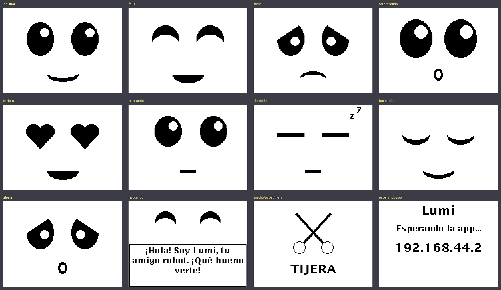

# Cambios del servidor EV3 (rama `social`)

Este documento explica qué se cambió en el programa del robot, por qué, y cómo usar lo nuevo.

## Resumen

| Antes | Ahora |
|---|---|
| El joystick respondía lento (~0.6 s por comando) | Responde al instante |
| La pantalla solo mostraba texto de consola | Cara animada con 9 expresiones y globo de texto |
| LEDs sin uso | LEDs según la emoción (fijos, pulsantes o alternados) |
| Voz robótica por defecto | Voz más aguda y amigable, configurable |
| Sensor IR solo se enviaba a la app | Freno de seguridad y saludo automático al acercarse alguien |
| Comandos de voz solo de movimiento | 8 comportamientos sociales + emociones + "decir texto" |
| Si la app se desconectaba había que reiniciar `main.py` | Vuelve a esperar la conexión solo |
| Un mensaje partido o un apóstrofo podían cerrar el programa | Mensajes armados con buffer; texto saneado |
| Odometría estimada con un tiempo fijo | Odometría con los encoders de los motores |

## Errores corregidos

1. **La garra bloqueaba el joystick.** Cada mensaje del joystick (varios por segundo) llamaba a `claw(False)`, que hacía girar la garra −90° y esperaba a que terminara (~0.5 s). Ese era el "0.6 s y no sé por qué" del comentario en `Odometer`. Ahora la garra solo se mueve cuando **cambia** su estado.
2. **Bucles sin pausa.** Los hilos de sensor y posición enviaban datos en un `while True` sin `sleep`, saturando el procesador del EV3. Ahora se envían 10 veces por segundo (`TELEMETRY_HZ`).
3. **Mensajes partidos.** `main.py` usaba `split("|")[-2]`; si un `recv()` traía medio mensaje, el programa fallaba. Ahora `MessageReader` arma mensajes completos.
4. **Instrucciones sin cantidad.** `f` o `b` sin valor lanzaban un error (`unit` no definido). Ahora tienen valores por defecto (20 cm).
5. **Apóstrofos.** `ev3dev2` pasa el texto a la shell entre comillas simples; un `'` rompía el comando de voz. Ahora se limpia.
6. **"Address already in use".** Al reiniciar el programa rápido, el puerto seguía ocupado. Ahora se usa `SO_REUSEADDR` y se escucha en todas las interfaces.

## Archivos

| Archivo | Qué hace |
|---|---|
| `main.py` | Arranque, espera de conexión, procesa mensajes de la app, reconexión |
| `config.py` | **Todo lo ajustable**: nombre, voz, velocidades, umbrales del sensor |
| `personality.py` | Cara en pantalla, LEDs y voz (nuevo) |
| `behaviors.py` | Comportamientos sociales (nuevo) |
| `commands.py` | Intérprete de instrucciones de texto (nuevo) |
| `movement.py` | Motores, garra, ejecución cancelable, odometría |
| `sensors.py` | Telemetría, freno de seguridad, saludo automático |
| `speech.py` | Canal "hacer hablar al robot" |
| `sockets.py` | Conexión TCP con la app |
| `utils.py` | Utilidades y registro en `log.txt` |

## Protocolo

La app envía por el puerto 8000 mensajes terminados en `|`:

- `stick:<x>;<y>;<garra>` — joystick (x, y entre −1 y 1; garra 1 = cerrada).
- `stick:*;<garra>` — se soltó el joystick (o se tocó el botón de la garra).
- `text:<instr>;<instr>;...` — órdenes de voz o botones.

Instrucciones de `text:`:

| Instrucción | Acción |
|---|---|
| `f-20-cm`, `f-1-m`, `f-2-s` | Adelante (cm, m o segundos). Sin valor: 20 cm |
| `b-...` | Atrás (igual que `f`) |
| `l-90-g`, `r-45-g`, `r-2-s` | Girar izquierda/derecha (`g` = grados del robot). Sin valor: 90° |
| `t-360-g` | Dar la vuelta |
| `p` / `d` | Agarrar / soltar |
| `s` | **Parar todo** (inmediato) |
| `g` | Saludar |
| `n` | Bailar (con música y luces) |
| `e` | Respiración guiada (3 ciclos, la luz crece al inhalar) |
| `c` | Celebrar (fanfarria, vuelta y frase de ánimo) |
| `j` | Contar un chiste |
| `x` | Piedra, papel o tijera (muestra la elección en pantalla) |
| `z` / `w` | Dormir / despertar |
| `m-feliz` | Cambiar la cara: feliz, triste, sorprendido, amor, pensando, calma, asustado, neutral |
| `h-<texto>` | Decir un texto |
| `a-1` / `a-0` | Activar / desactivar reacciones automáticas |

Una orden nueva **reemplaza** a la que se esté ejecutando. Mover el joystick o enviar `s` cancela cualquier comportamiento al instante.

El robot envía a la app:

- Puerto 8001: `ir:<0-100>;st:<emoción>;ac:<acción actual>`
- Puerto 8003: `<x>;<y>;<ángulo>` (1 unidad = 30 cm)

El puerto 8002 recibe texto que el robot dice y muestra en pantalla.

## Comportamiento autónomo

- **Freno de seguridad:** si el robot avanza y el sensor IR marca ≤ 12, se detiene, pone cara de "¡uy!", LED rojo y dice "¡Uy! Hay algo enfrente". No deja avanzar hasta que el obstáculo se aleja; sí deja retroceder y girar.
- **Saludo al acercarse:** si el robot lleva 4 s quieto y alguien se acerca (de > 45 a < 25), saluda. Espera 25 s entre saludos. Se desactiva con `a-0` o en `config.py`.
- **Parpadeo:** los ojos parpadean solos cada 2.5–6 s.

## Ajustes rápidos (`config.py`)

- `ROBOT_NAME`: nombre del robot (por defecto "Lumi").
- `VOICE_OPTS`: voz de espeak. Para voz femenina prueba `-v es+f3`; si el robot queda mudo, vuelve a `-v es`.
- `COMMAND_SPEED` / `BEHAVIOR_SPEED`: velocidad de órdenes y comportamientos.
- `TURN_CALIBRATION`: si "gira 90 grados" gira de menos, súbelo (p. ej. 1.15); si gira de más, bájalo.
- `SAFETY_STOP_PROXIMITY`, `GREET_*`: sensibilidad del sensor.

## Cómo instalarlo en el robot

1. Copia **todos** los `.py` a la misma carpeta del robot (con VS Code + extensión ev3dev-browser, o `scp *.py robot@<IP>:~/ev3_server/`).
2. Ejecuta `main.py` desde el menú del robot (o desde VS Code).
3. La pantalla mostrará el nombre, "Esperando la app..." y la IP.
4. Conecta la app. El robot sonríe y dice "¡Hola! Soy Lumi...".

Si algo falla, revisa `log.txt` en la misma carpeta: ahí quedan todos los mensajes de depuración.

## Cómo se probó

Sin el robot físico, se probó con un simulador de `ev3dev2` y una app simulada que se conecta por los 4 puertos. Pasaron 27 pruebas: joystick con mensajes partidos y pegados, garra, secuencias de voz, los 8 comportamientos, cancelación, freno de seguridad, saludo automático, dormir/despertar, desconexión y reconexión. Las caras se renderizaron con las fuentes reales del EV3 (tildes, ñ y ¡¿ incluidas). El código es compatible con Python 3.5 (el de ev3dev stretch).

**Pendiente de verificar en el robot real:** sentido de giro, calibración de giros, volumen de la voz y que la variante de voz funcione.
